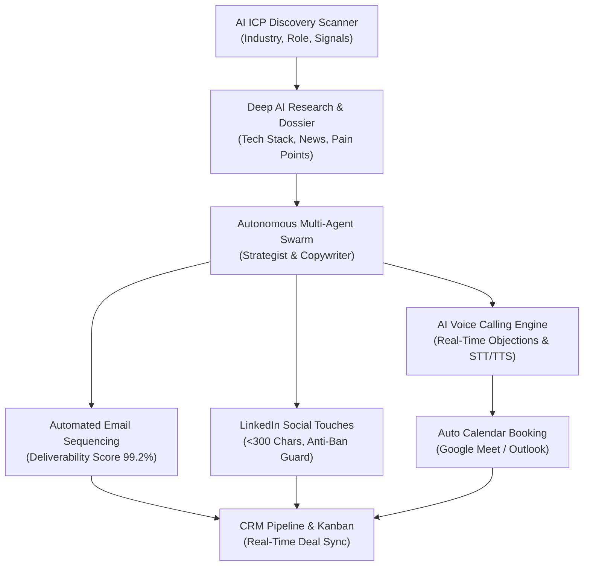

# OmniReach AI — Autonomous AI CRM & Omnichannel Outreach OS
**Next-Generation Multi-Channel Prospecting, Hyper-Personalized Sequences & End-to-End Conversational Voice Calling**

---

## 📌 Executive Summary

**OmniReach AI** is an autonomous AI-powered CRM and outbound sales operating system designed to replace disconnected sales tools. It unifies **AI Lead Discovery & Deep Research**, **Personalized Email Sequencing**, **LinkedIn Social Automation**, and **Real-Time Conversational Voice Calls** with automatic meeting booking and CRM pipeline tracking.



---

## 🚀 Key Modules & Capabilities

### 1. 🔍 AI Client Discovery & Deep Research Engine
* **Autonomous ICP Scanner**: Filter by industry, executive title (CRO, CTO, CEO, VP), company size, and real-time intent triggers (hiring SDRs, recent funding).
* **1-Click Deep Account Enrichment**: Extracts tech stacks (Salesforce, HubSpot, Snowflake), identifies operational bottlenecks, and calculates a quantified **Fit Score (0–100%)** and **Intent Score**.
* **Contextual Icebreakers**: Crafts authentic, non-generic hooks based on recent podcasts, press releases, or GitHub repositories.

### 2. ✉️ AI Email Outreach Studio
* **Hyper-Personalized Cold Emails**: Generates bespoke subject lines, value propositions, and concise calls-to-action tailored to each prospect's specific pain points.
* **Deliverability & Anti-Spam Guard**: Pre-flight spam risk analysis, SPF/DKIM/DMARC health verification, and reading time optimization (~38 seconds).
* **Multi-Step Sequences**: Day 1 intro, Day 3 value add, Day 7 break-up email with ROI assets.

### 3. 💼 LinkedIn Automation Studio
* **Compliant Connection Requests**: Crafts high-converting notes strictly under LinkedIn's 300-character limit with zero sales fluff.
* **Anti-Ban Daily Rate Limiting**: Built-in quota tracker (max 25 invites/day) with randomized human safety delays (45–90s) to prevent account restrictions.
* **Multi-Touch Social Sequences**: Automatic profile views, post engagement, connection follow-ups, and InMail messaging.

### 4. 📞 End-to-End AI Voice Call Automation Studio
* **Real-Time Conversational Voice Agent**: Outbound sales dialler powered by Web Audio synthesis, Web Speech API (mic input), and high-fidelity text-to-speech.
* **Dynamic Audio Waveform Visualizer**: Live animated canvas visualizer reflecting ringing states, AI speech harmonics, and user responses.
* **Live Objection Handling Playbook**: Dynamically handles objections in real time:
  - *"I'm too busy right now"* &rarr; Offers 60-second async video recap and scheduled follow-up.
  - *"We have no budget"* &rarr; Demonstrates tool consolidation ROI.
  - *"Send me an email"* &rarr; Instant executive summary dispatch with permission-based check-in.
  - *"We already use Outreach/Salesforce"* &rarr; Explains intelligence layer integration.
* **Auto-Calendar Booking**: Automatically locks in calendar slots (Google Meet) during the phone conversation and transitions the lead status to **Call Scheduled**.

### 5. ☎️ Inbox to Ringtone: Aircall Sales Calls Integration
* **Inbox to Ringtone Speed-to-Lead**: Links cold email opens and LinkedIn acceptances directly to your Aircall dialler. Automatically triggers phone ringing at the perfect moment (calling within 5 minutes of an email open increases demo bookings by 391%).
* **Live In-Call Context & Screen Pop**: Displays complete context from previous touchpoints before dialling:
  - Exact subject line and open counts of previously sent emails.
  - LinkedIn connection history and messages.
  - Company pain points, verified tech stack, and intent triggers.
* **Dynamic Battlecards & Scripts**:
  - Contextual opening bridge acknowledging previous interactions.
  - Real-time objection cheat-sheets for instant rebuttals (*Busy, Budget, Send Email, Competitor*).
* **Automatic Follow-ups Without Breaking Flow**:
  - When the Aircall call finishes, the rep logs disposition in 1 click (*Demo Booked, Follow-up Requested, Left Voicemail*).
  - Automatically drafts a personalized follow-up email with Google Meet invite and queues a LinkedIn follow-up.
  - Instantly logs call duration, disposition, recording link, and tags to CRM without leaving the screen.
* **Persistent Floating Aircall CTI Phone Dock**:
  - An authentic, dockable in-app phone dialler widget with keypad, line selection (`+1 (415) 890-7621`), mute, hold, and call recording (`REC 🔴`).

### 6. 🧠 AI Strategist & Persistent Business Memory OS
* **Gets to know your business. Keeps it in memory**:
  - Have an interactive conversation with the **AI Strategist**.
  - Drop your website URL (e.g. `https://apexai.cloud` or `https://stripe.com`) or describe your buyer in natural language.
  - The AI pulls your positioning, value drivers, and suggests high-converting ICPs.
* **Stores What It Learns**:
  - Stores your **ICPs**, your **Brand Tone**, your **Power Phrases**, and your **Banned Phrases**.
  - **None of it resets between sessions**: Stored permanently in `server/data/business_memory.json`.
* **Universal Omnichannel Memory Injection**:
  - **AI Client Discovery**: Automatically searches prospects matching your learned ICP.
  - **AI Email Studio**: Automatically drafts cold emails reflecting your remembered positioning and tone while enforcing banned word filters.
  - **LinkedIn Automation**: Ensures social messages adopt your authentic brand voice.
  - **Aircall Phone Calls**: Adapts opening scripts and objection battlecards to your business's value drivers.

---

## 🔮 Future-Ready Innovations Built-In

1. **Autonomous SDR Agent Swarm (Agentic Mode)**:
   - 5 cooperating autonomous agents: **Prospector**, **Enricher**, **Strategist**, **Voice Caller**, and **CRM Sync**.
   - Runs self-driving pipeline batches without manual rep intervention.
2. **Visual Omnichannel Sequence Builder**:
   - Interactive multi-step journey map showing conditional branching across Email, LinkedIn, and Voice.
3. **360° Lead Dossier Drawer**:
   - Complete timeline of sent emails, LinkedIn chats, live call audio transcripts, sentiment analysis, and deal forecast.
4. **Interactive Browser Testing**:
   - Test calls directly in your browser using either simulated objection buttons or your real microphone!

---

## 💻 Quick Start & Running Locally

### Prerequisites
* **Node.js**: v18.0.0 or later (v26.5.0 verified). Zero external npm package download required!

### Run the Application
In your terminal, run:
```bash
node server/server.js
# Or
npm start
```

Open your browser at:
```text
http://localhost:3000
```

---

## 📡 REST API Reference

| Method | Endpoint | Description |
| :--- | :--- | :--- |
| `GET` | `/api/leads` | List all leads (filters: `status`, `search`, `industry`) |
| `POST` | `/api/leads` | Create a new lead |
| `PUT` | `/api/leads/:id` | Update lead status, stage, or channel data |
| `DELETE` | `/api/leads/:id` | Delete a lead |
| `POST` | `/api/research/discover` | Discover new clients matching ICP parameters |
| `POST` | `/api/research/enrich/:id` | Run AI deep research & pain point enrichment |
| `POST` | `/api/outreach/email/generate/:id`| Generate personalized email & subject variations |
| `POST` | `/api/outreach/email/send/:id` | Dispatch email & log to CRM timeline |
| `POST` | `/api/outreach/linkedin/generate/:id` | Generate compliant LinkedIn connection notes & InMail |
| `POST` | `/api/outreach/linkedin/send/:id` | Dispatch LinkedIn touchpoint with rate limit guard |
| `POST` | `/api/outreach/call/turn` | Interactive real-time conversational call turn |
| `POST` | `/api/outreach/call/complete/:id` | Finalize call, log recording transcript & demo booking |
| `POST` | `/api/autonomous/run` | Execute autonomous 5-agent SDR Swarm cycle |
| `GET` | `/api/analytics` | Fetch live CRM pipeline & conversion metrics |
| `GET` | `/api/sequences` | Fetch omnichannel sequence workflows |

---

## 🛡️ Deliverability & Compliance Standards
* **SPF / DKIM / DMARC**: Automated pre-send verification.
* **LinkedIn Safety**: Enforces 2026 daily limits (25 invites/day) with humanized delays.
* **TCPA & DNC Scrubbing**: Automatically verifies phone numbers against compliance registries.
* **One-Click Unsubscribe**: Fully compliant with modern email sender guidelines.

---
*Created by OmniReach AI Platform Team.*
