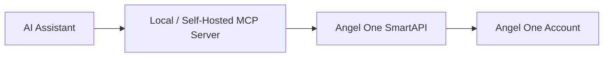

# AI Trading Connections — Beginner Guide
**Claude • Cursor • ChatGPT • Google Antigravity × INDmoney • Zerodha • Angel One • Groww**

---

## 📌 Executive Summary

You do **not** need to understand the Model Context Protocol (MCP) deeply to get started. 
Think of **MCP as a universal bridge** that lets AI assistants safely interact with your broker or financial services.

```mermaid
flowchart LR
    AI["AI App<br/>(Claude / Cursor / Antigravity / ChatGPT)"] -->|MCP Protocol| Bridge["MCP Bridge / Server"]
    Bridge -->|API Calls (HTTPS / Auth)| Broker["Broker / Trade API<br/>(INDmoney / Zerodha / Angel One / Groww)"]
    Broker --> Account["Your Account<br/>(Portfolio / Orders / Data)"]
```

---

## ⚡ Broker Comparison Matrix

| Broker | Official MCP Server? | Connection Type | Capabilities | Complexity |
| :--- | :--- | :--- | :--- | :--- |
| **INDmoney** | ✅ Yes (Official Hosted) | Remote MCP (`https://mcp.indmoney.com/mcp`) | Read-only (Holdings, Net Worth, Tracking) | 🟢 Easiest |
| **Zerodha** | ✅ Yes (Official Hosted & Open-Source) | Remote SSE / Local stdio | Market Data, Holdings, Orders, Positions | 🟢 Easy |
| **Angel One** | ❌ API Only (SmartAPI) | Custom / Community MCP Bridge → SmartAPI | Full Trading & Market Data | 🟡 Intermediate |
| **Groww** | ❌ API Only (Trade API) | Custom / Community MCP Bridge → Groww API | Orders, Portfolio, Live Quotes | 🟡 Intermediate |

---

## 1. INDmoney + Claude (Easiest)

INDmoney provides an official, remote, read-only MCP connection directly integrated with Claude.

### Setup Instructions
1. Open **Claude** (Web / Desktop).
2. Go to **Settings** → **Connectors** (or Integrations) → **Add custom connector**.
3. Enter the hosted MCP URL:
   ```text
   https://mcp.indmoney.com/mcp
   ```
4. Click **Connect**.
5. Complete authentication on INDmoney's login portal using your registered mobile number, OTP, and MPIN.
6. Approve access.

* **Official Setup & Info**: [INDmoney MCP](https://www.indmoney.com/mcp)
* **Hosted MCP Endpoint**: `https://mcp.indmoney.com/mcp`
* **Access Level**: Read-only portfolio analysis and tracking.

---

## 2. Zerodha + AI (Claude, Cursor, Antigravity)

Zerodha provides both the **Kite Connect API v3** and an **Official Kite MCP Server** (hosted and open-source).

### Official Links
* **Zerodha Support Connection Guide**: [Connect Zerodha AI Assistant](https://support.zerodha.com/category/trading-and-markets/general-kite/others-kite/articles/connect-zerodha-ai-assistant)
* **GitHub Repository**: [zerodha/kite-mcp-server](https://github.com/zerodha/kite-mcp-server)
* **Official Hosted Remote MCP Endpoint**:
  ```text
  https://mcp.kite.trade/mcp
  ```
* **Kite Connect Developer Portal**: [Kite Connect v3 Documentation](https://kite.trade/docs/connect/v3/)

### Client Configurations

#### Antigravity Configuration (`mcp_config.json` or `.agents/mcp_config.json`)
```json
{
  "mcpServers": {
    "zerodha-kite": {
      "url": "https://mcp.kite.trade/mcp"
    }
  }
}
```

#### Cursor Configuration (`.cursor/mcp.json` or Global MCP Settings)
```json
{
  "mcpServers": {
    "zerodha-kite": {
      "url": "https://mcp.kite.trade/mcp"
    }
  }
}
```

#### Claude Desktop Configuration (`claude_desktop_config.json`)
```json
{
  "mcpServers": {
    "zerodha-kite": {
      "url": "https://mcp.kite.trade/mcp"
    }
  }
}
```
*(Alternatively, you can run the open-source Python server locally via `uvx` or `pip` with your `KITE_API_KEY` and session token).*

---

## 3. Angel One + AI (SmartAPI)

Angel One provides **SmartAPI**, which allows programmatic trading and market data feeds. 
Angel One does **not** host a native remote MCP server, so you connect via an MCP bridge application that queries SmartAPI using your credentials.

### Setup Flow


### Steps to Connect
1. **Register Developer Account**: Sign up at [SmartAPI Portal](https://smartapi.angelone.in/).
2. **Create SmartAPI App**: Go to [Create App](https://smartapi.angelone.in/create) to obtain your `API_KEY` and `CLIENT_CODE`.
3. **Set Up MCP Bridge**: Run a SmartAPI MCP wrapper (e.g., using Python SmartAPI SDK: `pip install smartapi-python`).
4. **Configure AI Tool**: Add your local MCP bridge to your AI client's configuration file.

* **Developer Portal**: [SmartAPI Home](https://smartapi.angelone.in/)
* **Official Documentation**: [SmartAPI Docs](https://smartapi.angelone.in/docs)
* **App Creation**: [SmartAPI App Dashboard](https://smartapi.angelone.in/create)

---

## 4. Groww + AI (Groww Trading API)

Groww provides an official **Trading API**. Like Angel One, connecting Groww to an AI client requires an MCP bridge wrapper that translates MCP tool calls into Groww API requests.

### Key Capabilities
* Order placement and management
* Real-time live market data
* Portfolio holdings & positions
* Instrument master search

### Setup Flow
1. Generate API keys from Groww's developer dashboard.
2. Build or run an MCP server utilizing Groww's official Python SDK or HTTP REST endpoints.
3. Expose functions (e.g. `get_portfolio`, `get_quote`, `place_order`) to your AI client via MCP.

### Official Documentation Links
* **Trade API Documentation**: [Groww Trade API](https://groww.in/trade-api/docs)
* **cURL & Quickstart**: [Groww API cURL Guide](https://groww.in/trade-api/docs/curl)
* **Python SDK**: [Groww Python SDK](https://groww.in/trade-api/docs/python-sdk)
* **Orders API**: [Groww Orders Guide](https://groww.in/trade-api/docs/curl/orders)
* **Market Data API**: [Groww Live Data](https://groww.in/trade-api/docs/curl/live-data)
* **Portfolio API**: [Groww Portfolio](https://groww.in/trade-api/docs/curl/portfolio)
* **Instruments Master**: [Groww Instruments](https://groww.in/trade-api/docs/curl/instruments)

---

## 5. AI Client Official MCP Documentation

| Client | Official Documentation & Integration Guide |
| :--- | :--- |
| **Claude (Anthropic)** | [Anthropic MCP Docs](https://docs.anthropic.com/en/docs/mcp) |
| **Cursor** | [Cursor MCP Documentation](https://docs.cursor.com/context/model-context-protocol) |
| **ChatGPT / OpenAI** | [OpenAI API & Tool Integrations](https://platform.openai.com/docs/quickstart/make-your-first-api-request) |
| **Google Antigravity** | [Google Antigravity MCP Guide](https://www.antigravity.google/docs/mcp) |

---

## 🔒 Crucial Security Rules for AI Trading

> [!CAUTION]
> **Never paste credentials into chat prompts:**
> 1. **Do not** share your broker API Secret, Trading PIN, Password, or TOTP Secret seed inside an AI prompt or chat conversation.
> 2. Always store API keys in system environment variables (`.env`) or within the dedicated MCP config/connector settings.
> 3. **Start Read-Only**: Initially enable only portfolio inspection, market data, and order history tools. Test automated order execution only after thorough paper-trading and testing.
> 4. Keep order size limits and safety stops implemented in your backend bridge rather than relying solely on the LLM's judgment.
